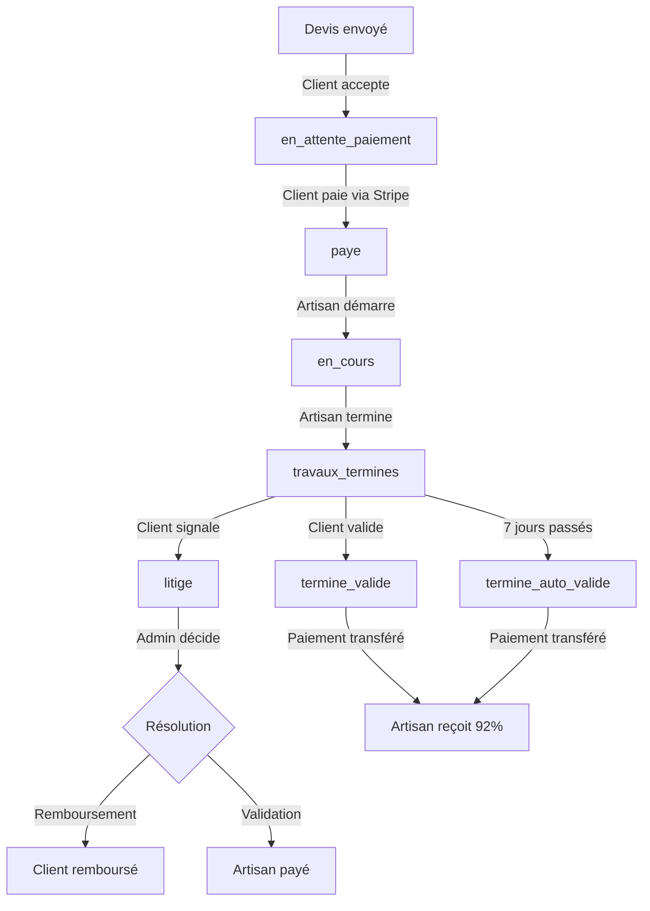

# 🔄 Workflow Complet : Signature, Paiement et Notifications

## 📋 Table des matières
1. [Vue d'ensemble du cycle de vie d'un devis](#vue-densemble)
2. [Étape par étape : De la signature à la validation finale](#étapes-détaillées)
3. [Notifications côté Client](#notifications-client)
4. [Notifications côté Artisan](#notifications-artisan)
5. [États Firestore et transitions](#états-firestore)
6. [Cas particuliers et edge cases](#cas-particuliers)

---

## Vue d'ensemble

### Statuts de devis disponibles

```typescript
type DevisStatut = 
  | 'genere'                    // 🟡 Brouillon (artisan en cours d'édition)
  | 'envoye'                   // 🔵 Envoyé au client (en attente décision)
  | 'en_revision'              // 🟣 En cours de révision (client a demandé modifications)
  | 'remplace'                 // ⚫ Remplacé par une nouvelle version
  | 'refuse'                   // 🔴 Refusé par le client
  | 'expire'                   // ⏰ Expiré (date validité dépassée)
  | 'en_attente_paiement'      // 💳 Accepté, en attente de paiement
  | 'paye'                     // ✅ Payé, contrat signé
  | 'en_cours'                 // 🚧 Travaux en cours
  | 'travaux_termines'         // 🏁 Artisan a déclaré fin des travaux
  | 'termine_valide'           // ✅ Client a validé les travaux
  | 'termine_auto_valide'      // ⏱️ Validation automatique après 7 jours
  | 'litige'                   // ⚠️ Client a signalé un problème
```

---

## Étapes détaillées

### 🎯 Étape 1 : Acceptation du devis par le client

**Lieu** : `/client/devis/[id]` (Page détail du devis)

**Action utilisateur** :
```tsx
<button onClick={() => accepterDevis()}>
  ✅ Accepter ce devis
</button>
```

**Code exécuté** (`devis-service.ts`) :
```typescript
export async function accepterDevis(devisId: string) {
  const devisRef = doc(db, 'devis', devisId);
  const devisSnap = await getDoc(devisRef);
  const devis = devisSnap.data() as Devis;
  
  // 1️⃣ Changer statut → en_attente_paiement
  await updateDoc(devisRef, {
    statut: 'en_attente_paiement',
    dateAcceptation: serverTimestamp(),
  });
  
  // 2️⃣ Créer notification pour l'artisan
  await createNotification({
    recipientId: devis.artisanId,
    type: 'devis_accepte',
    title: '🎉 Devis accepté !',
    message: `Votre devis a été accepté par le client`,
    relatedId: devisId,
    lien: `/artisan/devis/${devisId}`,
    isRead: false,
  });
  
  // 3️⃣ Envoyer email à l'artisan
  await sendEmailNotification({
    to: artisan.email,
    subject: '🎉 Votre devis a été accepté !',
    template: 'devis_accepte',
    context: { devis, artisan, client }
  });
}
```

**Résultat** :
- ✅ Devis passe en statut `en_attente_paiement`
- 🔔 Artisan reçoit notification "Devis accepté"
- 📧 Artisan reçoit email de confirmation
- 🔁 Client redirigé vers page de paiement Stripe

---

### 💳 Étape 2 : Paiement sécurisé (Stripe)

**Lieu** : `/client/paiement?devisId=xxx`

**Workflow Stripe** :
1. Client clique "Payer maintenant"
2. Stripe Checkout Session créée
3. Client redirigé vers Stripe (sécurisé)
4. Paiement effectué
5. Webhook Stripe notifie le backend

**Webhook Backend** (`/api/v1/stripe/webhook`) :
```typescript
const event = stripe.webhooks.constructEvent(
  req.body,
  signature,
  webhookSecret
);

if (event.type === 'checkout.session.completed') {
  const session = event.data.object;
  const devisId = session.metadata.devisId;
  
  // 1️⃣ Mettre à jour le devis
  await updateDoc(doc(db, 'devis', devisId), {
    statut: 'paye',
    paiement: {
      montant: session.amount_total / 100,
      date: serverTimestamp(),
      stripeSessionId: session.id,
      stripePaymentIntentId: session.payment_intent,
    }
  });
  
  // 2️⃣ Créer le contrat
  await addDoc(collection(db, 'contrats'), {
    devisId,
    clientId: devis.clientId,
    artisanId: devis.artisanId,
    statut: 'en_cours',
    dateSignature: serverTimestamp(),
    montantTTC: devis.totaux.totalTTC,
  });
  
  // 3️⃣ Notifier l'artisan
  await createNotification({
    recipientId: devis.artisanId,
    type: 'paiement_recu',
    title: '💰 Paiement reçu !',
    message: `Le client a payé le devis. Vous pouvez démarrer les travaux.`,
    relatedId: devisId,
    lien: `/artisan/devis/${devisId}`,
  });
  
  // 4️⃣ Notifier le client
  await createNotification({
    recipientId: devis.clientId,
    type: 'paiement_confirme',
    title: '✅ Paiement confirmé',
    message: 'Votre paiement a été accepté. L\'artisan va démarrer les travaux.',
    relatedId: devisId,
    lien: `/client/devis/${devisId}`,
  });
}
```

**Résultat** :
- ✅ Devis passe en statut `paye`
- 📝 Contrat créé dans Firestore
- 💰 Argent gardé en séquestre (Stripe Connect)
- 🔔 Client reçoit "Paiement confirmé"
- 🔔 Artisan reçoit "Paiement reçu"
- 📧 Emails envoyés aux deux parties

---

### 🚧 Étape 3 : Début des travaux

**Lieu** : `/artisan/demandes?demandeId=xxx`

**Action artisan** :
```tsx
<button onClick={() => demarrerTravaux(devisId)}>
  🚀 Démarrer les travaux
</button>
```

**Code** :
```typescript
export async function demarrerTravaux(devisId: string) {
  await updateDoc(doc(db, 'devis', devisId), {
    statut: 'en_cours',
    travaux: {
      dateDebut: serverTimestamp(),
    }
  });
  
  // Notification client
  await createNotification({
    recipientId: devis.clientId,
    type: 'travaux_demarres',
    title: '🚧 Travaux commencés',
    message: 'L\'artisan a démarré les travaux',
    relatedId: devisId,
    lien: `/client/devis/${devisId}`,
  });
}
```

**Où apparaît la notification ?**

**Côté Client** :
- 🔔 Badge notification dans UserMenu
- 📋 Section "Mes Devis" → Onglet "Payés" → Sous-filtre "Travaux en cours"
- 📄 Page `/client/devis` → Carte du devis affiche badge 🚧 "Travaux en cours"
- 📋 Page `/client/demandes` → Demande affiche statut "🚧 Travaux en cours"

**Côté Artisan** :
- 📋 Page `/artisan/devis` → Section "Payés" → Sous-filtre "En cours"
- 📄 Page `/artisan/demandes` → Demande affiche bouton "🏁 Déclarer fin des travaux"

---

### 🏁 Étape 4 : Fin des travaux déclarée par l'artisan

**Lieu** : `/artisan/demandes?demandeId=xxx`

**Action artisan** :
```tsx
<button onClick={() => declarerFinTravaux(devisId)}>
  🏁 Déclarer la fin des travaux
</button>
```

**Code** (`devis-service.ts`) :
```typescript
export async function declarerFinTravaux(
  devisId: string, 
  demandeId: string,
  artisanId: string
) {
  const dateFin = new Date();
  const dateValidationAuto = new Date();
  dateValidationAuto.setDate(dateValidationAuto.getDate() + 7); // +7 jours
  
  // 1️⃣ Mettre à jour le devis
  await updateDoc(doc(db, 'devis', devisId), {
    statut: 'travaux_termines',
    travaux: {
      dateFin: Timestamp.fromDate(dateFin),
      dateValidationAuto: Timestamp.fromDate(dateValidationAuto),
    }
  });
  
  // 2️⃣ NOTIFICATION 1 : Pour la page DEVIS du client
  await createNotification({
    recipientId: clientId,
    type: 'travaux_termines',
    title: '🏁 Travaux terminés !',
    message: 'L\'artisan a déclaré avoir terminé les travaux',
    relatedId: devisId,
    lien: `/client/devis/${devisId}`,
    isRead: false,
  });
  
  // 3️⃣ NOTIFICATION 2 : Pour la page DEMANDES du client (VALIDATION)
  await createNotification({
    recipientId: clientId,
    type: 'validation_requise',
    title: '🏁 Validation requise',
    message: 'L\'artisan a terminé les travaux. Validez ou signalez un problème (7 jours)',
    relatedId: demandeId,          // ⚠️ Lien vers DEMANDE
    lien: `/client/demandes?demandeId=${demandeId}`,
    metadata: {
      devisId,                      // Pour retrouver le devis
      dateValidationAuto: dateValidationAuto.toISOString(),
    },
    isRead: false,
  });
  
  // 4️⃣ Email au client
  await sendEmailNotification({
    to: client.email,
    subject: '🏁 Travaux terminés - Validation requise',
    template: 'travaux_termines',
    context: {
      artisan,
      devis,
      dateValidationAuto: dateValidationAuto.toLocaleDateString('fr-FR'),
      lienValidation: `${baseUrl}/client/demandes?demandeId=${demandeId}`,
    }
  });
}
```

**Résultat** :
- ✅ Devis passe en statut `travaux_termines`
- 🕐 Timer de 7 jours activé pour validation automatique
- 🔔 Client reçoit **2 notifications** :
  1. "Travaux terminés" → Lien vers `/client/devis/${devisId}`
  2. "Validation requise" → Lien vers `/client/demandes?demandeId=${demandeId}`
- 📧 Email envoyé au client

**Où apparaissent les notifications ?**

**Côté Client - Page Devis** (`/client/devis`) :
```tsx
// Carte du devis affiche badge orange
<div className="bg-orange-50 border-2 border-orange-500">
  <h3>🏁 Travaux terminés - En attente de validation</h3>
  <p>
    L'artisan a déclaré avoir terminé les travaux le {dateFin}.
    Vous avez 7 jours pour valider ou signaler un problème.
  </p>
  <p className="text-sm text-orange-700">
    Validation automatique le : {dateValidationAuto}
  </p>
  
  {/* Message informatif - PAS de boutons ici */}
  <div className="bg-blue-50 p-3 rounded">
    <p>💡 Pour valider ou signaler un problème, 
       rendez-vous sur la page de votre demande</p>
  </div>
</div>
```

**Côté Client - Page Demandes** (`/client/demandes?demandeId=xxx`) :
```tsx
// Message "Travaux déclarés terminés"
<div className="bg-green-50 border-l-4 border-green-500 p-4">
  <p className="font-semibold text-green-800">
    ✅ Travaux déclarés terminés
  </p>
  <p className="text-sm text-green-700">
    L'artisan a déclaré avoir terminé les travaux le {dateFin}
  </p>
</div>

{/* Bloc orange séparé avec boutons d'action */}
<div className="bg-orange-50 border-2 border-orange-500 p-6 mt-4">
  <h3 className="text-lg font-bold text-orange-800">
    🏁 Validation requise
  </h3>
  <p className="text-orange-700">
    Vous avez <strong>7 jours</strong> pour valider ou signaler un problème
  </p>
  <p className="text-sm text-orange-600">
    Validation automatique : {dateValidationAuto}
  </p>
  
  <div className="flex gap-3 mt-4">
    <button 
      onClick={() => validerTravaux(devisId)}
      className="bg-green-600 text-white px-6 py-3 rounded-lg"
    >
      ✅ Valider les travaux
    </button>
    <button 
      onClick={() => signalerLitige(devisId)}
      className="bg-red-600 text-white px-6 py-3 rounded-lg"
    >
      ⚠️ Signaler un problème
    </button>
  </div>
</div>
```

**Côté Artisan** (`/artisan/devis/${devisId}`) :
```tsx
<div className="bg-orange-50 border-2 border-orange-500 p-6">
  <h3>⏳ En attente de validation client</h3>
  <p>
    Vous avez déclaré avoir terminé les travaux le {dateFin}.
    Le client a 7 jours pour valider ou signaler un problème.
  </p>
  <p>Validation automatique le : {dateValidationAuto}</p>
  
  <div className="bg-green-50 p-3 rounded border border-green-200">
    <p className="text-green-800">
      💰 <strong>Paiement</strong> : Vous recevrez 
      <strong>{montantTTC * 0.92}€</strong> après validation
      <br />
      <span className="text-xs">(Commission : {montantTTC * 0.08}€)</span>
    </p>
  </div>
</div>
```

---

### ✅ Étape 5a : Validation par le client (OPTION 1)

**Lieu** : `/client/demandes?demandeId=xxx`

**Action client** :
```tsx
<button onClick={() => validerTravaux(devisId)}>
  ✅ Valider les travaux
</button>
```

**Code** (`devis-service.ts`) :
```typescript
export async function validerTravaux(
  devisId: string,
  demandeId: string,
  clientId: string,
  artisanId: string,
  montantTTC: number
) {
  const now = new Date();
  
  // 1️⃣ Mettre à jour le devis
  await updateDoc(doc(db, 'devis', devisId), {
    statut: 'termine_valide',
    travaux: {
      dateValidationClient: Timestamp.fromDate(now),
    }
  });
  
  // 2️⃣ Mettre à jour le contrat
  await updateDoc(doc(db, 'contrats', contratId), {
    statut: 'termine',
    dateFin: serverTimestamp(),
  });
  
  // 3️⃣ Libérer le paiement à l'artisan
  const commission = montantTTC * 0.08;
  const montantArtisan = montantTTC * 0.92;
  
  // Cloud Function Stripe → Transfert vers compte artisan
  await stripe.transfers.create({
    amount: montantArtisan * 100, // centimes
    currency: 'eur',
    destination: artisan.stripeAccountId,
    metadata: { devisId, demandeId }
  });
  
  // 4️⃣ Mettre à jour le chiffre d'affaires artisan
  await updateDoc(doc(db, 'artisans', artisanId), {
    'wallet.chiffreAffaires': increment(montantArtisan),
    'wallet.derniereTransaction': serverTimestamp(),
  });
  
  // 5️⃣ Notification artisan
  await createNotification({
    recipientId: artisanId,
    type: 'travaux_valides',
    title: '🎉 Travaux validés !',
    message: `Le client a validé les travaux. Vous avez reçu ${montantArtisan}€`,
    relatedId: devisId,
    lien: `/artisan/devis/${devisId}`,
  });
  
  // 6️⃣ Notification client
  await createNotification({
    recipientId: clientId,
    type: 'validation_confirmee',
    title: '✅ Validation confirmée',
    message: 'Vous avez validé les travaux. Le paiement a été transféré à l\'artisan.',
    relatedId: devisId,
    lien: `/client/devis/${devisId}`,
  });
  
  // 7️⃣ Emails
  await sendEmailNotification({
    to: artisan.email,
    subject: '🎉 Travaux validés - Paiement transféré',
    template: 'travaux_valides',
  });
}
```

**Popup immédiat après validation** :
```tsx
// Après validation réussie, popup pour demander un avis
const handleValidation = async () => {
  await validerTravaux(devisId, ...);
  
  // Afficher popup
  const donnerAvis = confirm(
    "✅ Travaux validés avec succès !\n\n" +
    "Voulez-vous donner votre avis sur cette prestation ?"
  );
  
  if (donnerAvis) {
    router.push(`/client/avis/nouveau?devisId=${devisId}`);
  }
};
```

**Résultat** :
- ✅ Devis passe en statut `termine_valide`
- 💰 Paiement transféré à l'artisan (92% du montant)
- 💼 Chiffre d'affaires artisan mis à jour
- 🔔 Artisan reçoit "Travaux validés + montant reçu"
- 🔔 Client reçoit "Validation confirmée"
- ⭐ Popup demande au client de donner un avis
- 📧 Emails envoyés

---

### ⏱️ Étape 5b : Validation automatique (OPTION 2)

**Déclencheur** : Cloud Function cron (ou script backend)

**Fréquence** : Toutes les heures

**Code Cloud Function** :
```typescript
export const autoValiderTravaux = functions.pubsub
  .schedule('every 1 hours')
  .onRun(async () => {
    const now = admin.firestore.Timestamp.now();
    
    // Trouver tous les devis en attente depuis +7 jours
    const snapshot = await admin.firestore()
      .collection('devis')
      .where('statut', '==', 'travaux_termines')
      .where('travaux.dateValidationAuto', '<=', now)
      .get();
    
    for (const doc of snapshot.docs) {
      const devis = doc.data();
      
      // Même logique que validation manuelle
      await validerTravaux(
        doc.id,
        devis.demandeId,
        devis.clientId,
        devis.artisanId,
        devis.totaux.totalTTC
      );
      
      // Mettre statut spécial
      await doc.ref.update({
        statut: 'termine_auto_valide', // Différent de termine_valide
      });
      
      // Notification spécifique
      await createNotification({
        recipientId: devis.clientId,
        type: 'validation_automatique',
        title: '⏱️ Validation automatique',
        message: 'Les travaux ont été automatiquement validés après 7 jours',
        relatedId: doc.id,
      });
    }
  });
```

---

### ⚠️ Étape 5c : Signalement d'un problème (OPTION 3)

**Lieu** : `/client/demandes?demandeId=xxx`

**Action client** :
```tsx
<button onClick={() => signalerLitige(devisId)}>
  ⚠️ Signaler un problème
</button>
```

**Code** :
```typescript
export async function signalerLitige(
  devisId: string,
  demandeId: string,
  clientId: string,
  artisanId: string,
  motif: string
) {
  // 1️⃣ Mettre à jour le devis
  await updateDoc(doc(db, 'devis', devisId), {
    statut: 'litige',
    litige: {
      dateSignalement: serverTimestamp(),
      motif,
      auteur: 'client',
    }
  });
  
  // 2️⃣ Bloquer le paiement (Stripe Hold)
  await stripe.paymentIntents.update(paymentIntentId, {
    metadata: { litigeId: devisId, statut: 'litige' }
  });
  
  // 3️⃣ Notification artisan
  await createNotification({
    recipientId: artisanId,
    type: 'litige_signale',
    title: '⚠️ Problème signalé',
    message: 'Le client a signalé un problème sur les travaux',
    relatedId: devisId,
    lien: `/artisan/devis/${devisId}`,
  });
  
  // 4️⃣ Notification client
  await createNotification({
    recipientId: clientId,
    type: 'litige_ouvert',
    title: '⚠️ Problème enregistré',
    message: 'Votre signalement a été enregistré. Notre équipe va vous contacter.',
    relatedId: devisId,
  });
  
  // 5️⃣ Notification admin
  await createNotification({
    recipientId: ADMIN_UID,
    type: 'nouveau_litige',
    title: '🚨 Nouveau litige',
    message: `Litige signalé sur devis ${devisId}`,
    lien: `/admin/litiges/${devisId}`,
  });
  
  // 6️⃣ Email équipe support
  await sendEmailNotification({
    to: 'support@artisandispo.fr',
    subject: '🚨 URGENT - Nouveau litige',
    template: 'nouveau_litige_admin',
  });
}
```

---

## Notifications Client

### 📍 Où apparaissent les notifications ?

#### 1. Badge UserMenu (en haut à droite)
```tsx
<NotificationBadge />
// Affiche compteur de notifications non lues
// Exemple : 🔔 3
```

#### 2. Dropdown UserMenu
```tsx
<UserMenu />
// Liste des 5 dernières notifications
// Bouton "Voir toutes les notifications"
```

#### 3. Page "/client/devis"
- Badge 🔔 sur les cartes de devis ayant des notifications non lues
- Exemples :
  - 🟢 "Devis envoyé" → Section "En attente"
  - 🔵 "Paiement confirmé" → Section "Payés"
  - 🟠 "Travaux terminés" → Section "Payés" → Sous-filtre "Travaux en cours"

#### 4. Page "/client/demandes"
- Badge 🔔 sur les cartes de demandes
- Bloc orange "🏁 Validation requise" quand travaux terminés
- Boutons d'action : "✅ Valider" et "⚠️ Signaler"

### 📊 Types de notifications reçues par le client

| Type | Titre | Message | Lien | Contexte |
|------|-------|---------|------|----------|
| `devis_recu` | 📬 Nouveau devis reçu | Un artisan vous a envoyé un devis | `/client/devis/${devisId}` | Après envoi par artisan |
| `devis_revision` | 🔄 Devis révisé | L'artisan a envoyé une nouvelle version | `/client/devis/${devisId}` | Après révision demandée |
| `paiement_confirme` | ✅ Paiement confirmé | Votre paiement a été accepté | `/client/devis/${devisId}` | Après paiement Stripe |
| `travaux_demarres` | 🚧 Travaux commencés | L'artisan a démarré les travaux | `/client/devis/${devisId}` | Début travaux |
| `travaux_termines` | 🏁 Travaux terminés | L'artisan a terminé les travaux | `/client/devis/${devisId}` | Fin travaux |
| `validation_requise` | 🏁 Validation requise | Validez ou signalez un problème (7j) | `/client/demandes?demandeId=${demandeId}` | Fin travaux |
| `validation_automatique` | ⏱️ Validation auto | Travaux validés automatiquement | `/client/devis/${devisId}` | Après 7 jours |
| `litige_ouvert` | ⚠️ Problème enregistré | Support va vous contacter | `/client/devis/${devisId}` | Après signalement |

---

## Notifications Artisan

### 📍 Où apparaissent les notifications ?

#### 1. Badge UserMenu
```tsx
<NotificationBadge />
// Compteur notifications non lues
```

#### 2. Page "/artisan/devis"
- Badge 🔔 sur cartes de devis
- Sections :
  - "En attente" → Devis envoyés
  - "Acceptés" → En attente paiement
  - "Payés" → Sous-filtres (Signés, En cours, Terminés, Validés)

#### 3. Page "/artisan/demandes"
- Badge 🔔 sur cartes de demandes
- Bouton "🏁 Déclarer fin des travaux" quand `statut === 'en_cours'`

### 📊 Types de notifications reçues par l'artisan

| Type | Titre | Message | Lien | Contexte |
|------|-------|---------|------|----------|
| `devis_accepte` | 🎉 Devis accepté | Le client a accepté votre devis | `/artisan/devis/${devisId}` | Après acceptation client |
| `paiement_recu` | 💰 Paiement reçu | Le client a payé. Démarrez les travaux | `/artisan/devis/${devisId}` | Après paiement |
| `travaux_valides` | 🎉 Travaux validés | Client a validé. Vous avez reçu XXX€ | `/artisan/devis/${devisId}` | Validation client |
| `litige_signale` | ⚠️ Problème signalé | Client a signalé un problème | `/artisan/devis/${devisId}` | Signalement litige |
| `demande_revision` | 🔄 Révision demandée | Client demande modification | `/artisan/devis/nouveau?demandeId=${demandeId}` | Client refuse devis |

---

## États Firestore et transitions

### Document `devis`

```typescript
{
  id: string,
  statut: 'paye' | 'en_cours' | 'travaux_termines' | 'termine_valide' | 'termine_auto_valide' | 'litige',
  
  paiement: {
    montant: number,
    date: Timestamp,
    stripeSessionId: string,
    stripePaymentIntentId: string,
  },
  
  travaux: {
    dateDebut?: Timestamp,          // Quand statut → en_cours
    dateFin?: Timestamp,            // Quand statut → travaux_termines
    dateValidationAuto?: Timestamp, // dateFin + 7 jours
    dateValidationClient?: Timestamp, // Quand statut → termine_valide
  },
  
  litige?: {
    dateSignalement: Timestamp,
    motif: string,
    auteur: 'client' | 'artisan',
    resolution?: {
      date: Timestamp,
      decision: string,
    }
  }
}
```

### Document `notifications`

```typescript
{
  id: string,
  recipientId: string,        // UID du destinataire
  type: string,               // Type de notification (voir tableaux ci-dessus)
  title: string,              // Titre court
  message: string,            // Message descriptif
  relatedId?: string,         // ID du devis/demande/contrat
  lien?: string,              // URL de redirection
  metadata?: {
    devisId?: string,
    demandeId?: string,
    dateValidationAuto?: string,
  },
  isRead: boolean,            // false par défaut
  createdAt: Timestamp,
}
```

### Document `contrats`

```typescript
{
  id: string,
  devisId: string,
  clientId: string,
  artisanId: string,
  statut: 'en_cours' | 'termine' | 'annule',
  dateSignature: Timestamp,   // Date paiement
  dateFin?: Timestamp,        // Date validation
  montantTTC: number,
}
```

---

## Cas particuliers

### ❓ Que se passe-t-il si le client ne paie jamais ?

**Réponse** : Devis reste en `en_attente_paiement` pendant 48h, puis expire automatiquement.

```typescript
// Cloud Function
export const expirerDevisNonPayes = functions.pubsub
  .schedule('every 6 hours')
  .onRun(async () => {
    const h48ago = admin.firestore.Timestamp.fromDate(
      new Date(Date.now() - 48 * 60 * 60 * 1000)
    );
    
    const snapshot = await admin.firestore()
      .collection('devis')
      .where('statut', '==', 'en_attente_paiement')
      .where('dateAcceptation', '<=', h48ago)
      .get();
    
    for (const doc of snapshot.docs) {
      await doc.ref.update({ statut: 'expire' });
      
      // Notification artisan
      await createNotification({
        recipientId: doc.data().artisanId,
        type: 'devis_expire',
        title: '⏰ Devis expiré',
        message: 'Le client n\'a pas payé dans les 48h',
      });
    }
  });
```

---

### ❓ Le client peut-il annuler après paiement ?

**Réponse** : NON. Une fois `statut === 'paye'`, impossible d'annuler. Seul recours = signaler un litige.

**Exception** : Dans les **24 premières heures**, l'admin peut forcer un remboursement.

---

### ❓ Que se passe-t-il en cas de litige ?

**Workflow** :
1. Client signale → `statut: 'litige'`
2. Paiement Stripe bloqué (hold)
3. Admin reçoit notification
4. Admin contacte client + artisan
5. Décisions possibles :
   - Remboursement total → Client
   - Remboursement partiel → Client + Artisan
   - Validation forcée → Artisan

**Code admin** :
```typescript
// Remboursement total
await stripe.refunds.create({
  payment_intent: devis.paiement.stripePaymentIntentId,
  amount: devis.totaux.totalTTC * 100,
});

// Remboursement partiel
await stripe.refunds.create({
  payment_intent: devis.paiement.stripePaymentIntentId,
  amount: (devis.totaux.totalTTC * 0.5) * 100, // 50%
});

// Transfert partiel artisan
await stripe.transfers.create({
  amount: (devis.totaux.totalTTC * 0.5 * 0.92) * 100,
  destination: artisan.stripeAccountId,
});
```

---

## Résumé du flux complet



---

## 🔧 Debug : Vérifier les notifications

**Console Firestore** :
```javascript
// Voir toutes les notifications d'un utilisateur
db.collection('notifications')
  .where('recipientId', '==', 'UID_DU_CLIENT')
  .orderBy('createdAt', 'desc')
  .get()
  .then(snap => snap.forEach(doc => console.log(doc.data())));
```

**Logs frontend** :
```typescript
// Dans useNotifications hook
useEffect(() => {
  console.log('🔔 Notifications:', notifications);
  console.log('📊 Non lues:', unreadCount);
}, [notifications, unreadCount]);
```

---

## 📝 Checklist développeur

- [ ] Webhook Stripe configuré et testé
- [ ] Cloud Functions déployées (auto-validation, expiration)
- [ ] Emails transactionnels activés (SendGrid/Mailgun)
- [ ] Stripe Connect configuré pour chaque artisan
- [ ] Tests E2E du workflow complet
- [ ] Logs de débogage activés en dev
- [ ] Monitoring des échecs de paiement
- [ ] Gestion des erreurs réseau (retry)
- [ ] Dashboard admin pour litiges

---

**Document créé le** : 1er avril 2026  
**Dernière mise à jour** : 1er avril 2026  
**Version** : 1.0
